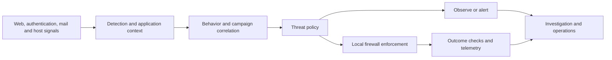

# Aegis Defender

**Coordinated server defense. From attack evidence to automated response.**

Aegis Defender brings application-aware threat detection, behavioral correlation, service authentication defense, and policy-controlled firewall enforcement into one coordinated host defense system.

It connects what an attacker is doing across web applications and server services, evaluates the evidence, and can automatically interrupt further traffic from identified attack sources.

[Product website](https://aegiscds.com) · [Architecture](docs/ARCHITECTURE.md) · [Evaluation guide](docs/EVALUATION.md) · [Security reporting](SECURITY.md)

## About this repository

This is the public technical documentation and evaluation repository for Aegis Defender. The commercial product source code, deployment packages, private intelligence feeds, and operational data are maintained separately and are not included here. Cloning this repository downloads documentation; it does not install Aegis.

## What Aegis brings together

| Capability | Role in coordinated defense |
| --- | --- |
| Web exploit detection | Identifies SQL injection, command injection, traversal, file-inclusion patterns, sensitive-file probes, and known webshell probes in inspected request data. |
| Application context | Uses discovered CMS installations and route context to assess suspicious probing. |
| Behavioral reconnaissance detection | Tracks bursts and persistent probing across observation windows. |
| Distributed campaign intelligence | Connects related attack activity across sources, routes, and sites. |
| Service authentication defense | Evaluates SSH, cPanel/WHM, FTP, and CMS authentication signals through supported sensors. |
| Mail defense | Correlates SMTP and optional IMAP/POP3 attack activity, including rotating-IP campaigns against accounts across configurable 1-, 6-, and 24-hour windows. |
| Threat policy and enforcement | Selects observe, alert, or block responses; supports temporary and permanent exact-IP enforcement. |
| Network escalation | Evaluates broader network candidates using local evidence, provider/ASN/country context, route verification, and operator safeguards. |
| Firewall integrity recovery | Detects severe deny-file rule loss and supports guarded recovery from a known-good baseline. |
| Host visibility | Monitors configured critical files, privileged activity, and suspicious web-process descendants. |
| Operations and integrations | Provides health telemetry and optional Splunk and shared-intelligence integration. |

Effective behavior depends on the product version, installed integrations, sensor availability, and operator policy. See the architecture guide for response boundaries.

## Defense against autonomous attack workflows

AI-driven frameworks such as ARTEX accelerate reconnaissance, exploitation attempts, and adaptation. Aegis addresses attack behaviors through coordinated detection and automatic response, giving defenders opportunities to interrupt the progression from probing to follow-on access.

The evaluation guide defines how to test these opportunities, including distributed sources, persistent reconnaissance, authentication campaigns, enforcement latency, and legitimate traffic. It does not claim a measured ARTEX prevention result. Test plans and published results are separate artifacts.

## Product architecture

Watchdog supplies the local detection, correlation, policy, and enforcement engine described here. Guardian, CSOC, and Enterprise add product components for connected hosts, centralized operations, and broader orchestration. Decision Ledger and Replay interfaces are separate components that consume evidence and outcomes.

This documentation focuses on the reviewed Linux Watchdog integration. It does not establish Windows feature parity or uniform capabilities across every product edition.

## Evaluate Aegis

1. Review the [architecture and trust boundaries](docs/ARCHITECTURE.md).
2. Obtain a supported commercial evaluation build through [Aegis](https://aegiscds.com/contact-us).
3. Follow the [evaluation guide](docs/EVALUATION.md) in an authorized, isolated environment.
4. Record results using the [evaluation report template](docs/EVALUATION-REPORT.md).

## Documentation baseline

Prepared November 25, 2026. Detailed capability descriptions derive from a November 2, 2026 source review of Linux Watchdog `2.12.32-csf-logdrop-verify`. A later local development file declares `2.12.34-cmd-security`; that version observation is not a review of its changes or evidence of a deployed release. Evaluate the exact supplied build and effective configuration.

## Contact

Charlie Trig (Charles Triglianos) · Aegis Cyber Defense Systems  
Email: ctrig@trigwebdesign.com  
Phone: 617-819-5877 | 800-626-3520  
Website: https://aegiscds.com

Government procurement contact: Trig Web Design, LLC  
GSA MAS Contract: **47QTCA22D00BJ** · UEI: **KZVLG45QLW54** · CAGE: **6RM41**  
33A Rebecca Circle, Hudson, NH 03051

Contact us to confirm applicable products, scope, and ordering terms under the current contract.

## Rights and contributions

See [NOTICE](NOTICE) for rights information. Documentation corrections and evaluation-method feedback are welcome through the contact above. Report security concerns privately using [SECURITY.md](SECURITY.md).
