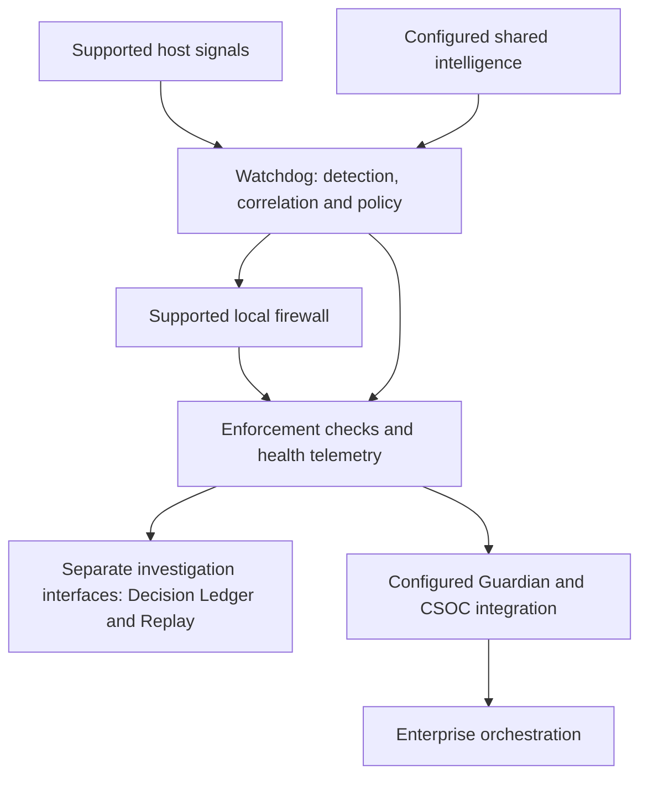

# Architecture

## Coordinated host defense

Aegis combines multiple security functions around a common local decision and response workflow. Watchdog consumes supported signals, enriches them with application and infrastructure context, correlates behavior, and applies operator policy. Enforcement outcomes and health information support investigation and operational oversight.

## Processing layers

| Layer | Responsibilities |
| --- | --- |
| Inputs | Apache access logs; supported SSH, cPanel/WHM, FTP, Exim and optional Dovecot logs; configured application/WAF events; host sensors. |
| Context | CMS discovery and path resolution; installed application information; source trust; provider, ASN and country context; optional reputation enrichment. |
| Detection | Exploit patterns, authentication failures, mail abuse, reconnaissance, file changes, privileged actions and suspicious runtime ancestry. |
| Correlation | Burst and persistent windows, repeated signals, distributed web campaigns, cross-account patterns and account-centric rotating-IP mail campaigns. |
| Policy | Evidence-aware observe, alert or block decisions; configurable exceptions and enforcement modes. |
| Enforcement | Temporary/permanent exact-IP action and separately guarded CIDR escalation through the supported firewall integration. |
| Accounting | Outcome checks, audit events, health snapshots and optional configured exports. |

## Application context

The reviewed Linux integration discovers cPanel virtual hosts and document roots, recognizes WordPress, Joomla, Moodle and Drupal fingerprints, and resolves nested application paths. Request-family mismatch logic specifically compares WordPress, Joomla and Moodle routes with the discovered installation. Installed Joomla extension context helps distinguish valid paths from arbitrary scanner targets.

Context is one input to the decision. A familiar route, referrer or user agent is not proof of an authenticated application session.

## Campaign correlation

Web campaign tracking records attack families, routes, distinct sources, sites and progression. Qualifying same-site/same-route distributed evidence can contribute confirmed attack evidence. Broader cross-site observations provide context without independently authorizing broader firewall scope.

The separate ModSecurity distributed-campaign path can attempt exact-IP action against previously observed participants when its qualifying threshold is met. This path suppresses automatic CIDR escalation.

Mail correlation includes account-centric windows of 1, 6 and 24 hours. Rotating-IP mail campaigns use exact-IP response paths rather than automatically authorizing network-wide action. Successful-login history and travel-grace handling reduce mistaken promotion of legitimate roaming-user activity.

## Trust boundaries

- Normalized events are accepted from configured trusted producers. Producer-supplied actions are removed; local policy determines the response.
- Event identifiers, timestamps, known event types, source checks and duplicate handling constrain accepted evidence.
- Local addresses, protected infrastructure and explicit allow/ignore policies constrain enforcement.
- Broader network escalation is separate from exact-IP action and requires its own evidence and policy checks.
- Optional reputation services enrich decisions; conclusive local signals can act without waiting for a third-party report.
- Configured shared-intelligence evaluation validates expiry, confidence and reporter requirements and tracks ownership for withdrawal. Transport, signature validation and fleet control depend on surrounding components.

## Response and verification

The local enforcement workflow checks existing coverage, coordinates writes with locking, executes the firewall action, records command outcomes, and performs outcome checks.

Temporary action checks live ipset or DENYIN evidence. Permanent verification in the reviewed implementation checks deny-file coverage. An independently observed connection test is required to establish packet-path blocking. Do not treat a requested action or a deny-file entry as proof that every network path is blocked.

Firewall integrity recovery maintains a known-good deny-file baseline and checks for substantial rule loss. Repeated confirmations, maintenance controls, forensic copies and locked recovery support guarded restoration. This is deny-file protection, not a guarantee against a fully compromised root account.

## Host monitoring

Configured critical-file hashing observes content and metadata changes. Privilege monitoring records relevant account and administrative activity. Runtime monitoring uses audit execution records or process polling to identify suspicious descendants of web/PHP processes.

These paths are observational in the reviewed integration. Their events do not imply process termination, malware removal, write prevention or rollback.

## Product components

This is a conceptual component view, not a network protocol or deployment specification. Availability and connectivity must be confirmed for the evaluation build and edition. Watchdog's local policy and enforcement functions are distinct from fleet transport and centralized management.

## Deployment scope and operating modes

The reviewed implementation centers on Linux, Apache and a CSF-based firewall integration, with cPanel discovery and supported service logs. Confirm distribution, firewall backend, log formats, resource requirements, IPv4/IPv6 handling and edition requirements before deployment. The reviewed principal native access-log parser is IPv4-oriented; this document does not establish full IPv6 coverage.

Several sensors and integration paths support observe-only or log-only operation. cPanel/CMS authentication and CMS Guard have important default-mode distinctions. CIDR escalation is disabled/dry-run by default in the reviewed code. Effective configuration, rather than the presence of a detector, determines whether a path enforces.

Native access-log inspection generally follows processing of the triggering request. It can interrupt subsequent traffic but does not establish prevention of that first request. Native URI inspection does not see ordinary POST bodies, uploaded content or application session state; configured WAF/application integrations can add evidence.

## Evidence baseline

These descriptions summarize the November 2, 2026 review of Linux Watchdog `2.12.32-csf-logdrop-verify`. They are architectural evidence, not benchmark results or a certification. Revalidate capabilities and defaults against the exact build under evaluation. No product source or internal filesystem paths are included in this repository.
